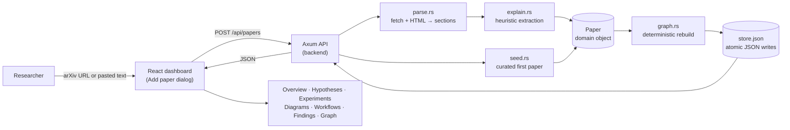
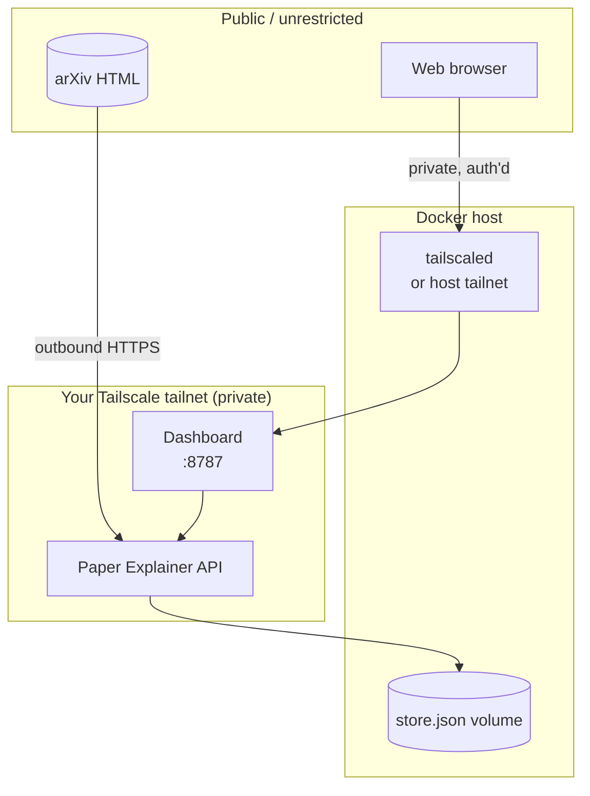

# How this app works

Paper Explainer turns a research paper into a **structured, visual explanation**: the claims it makes, the experiments it runs, the findings it reports, diagrams that redraw its ideas, and a knowledge graph that connects it to every other paper you add.

The guiding idea is that reading a paper is two jobs: *understanding one paper deeply*, and *seeing how many papers relate*. The dashboard has a view for each.

## The one-paragraph version

You add a paper by URL or by pasting text. The Rust backend fetches and parses it, deterministically extracts hypotheses, experiments, findings and concepts, generates Mermaid diagrams and workflows, and rebuilds a shared knowledge graph. The React frontend renders all of that — the explanations as cards, the diagrams as interactive SVGs, and the graph as a force-directed network. Everything is saved to a single JSON file, so the collection grows as you add papers.

## End-to-end flow

## Two extraction paths

Not every paper is created equal, so there are two ways content enters the system.

| Path | Source | When | Fidelity |
|---|---|---|---|
| Curated | `backend/src/seed.rs` | First paper, preloaded | Hand-written from full text, tables and appendices |
| Heuristic | `backend/src/explain.rs` | Any new URL or pasted text | Deterministic rules; transparent, first-pass |

The curated seed is the CCS '26 paper on the security boundary of obfuscation-based on-device LLM protection. It demonstrates the depth the format can hold. New papers get a useful automatic explanation that you can inspect immediately — no API key or LLM call required.

> The graph is **rebuilt from all papers** after every change, so adding a paper can create new bridges between concepts that were already present.

## Actors and trust boundaries

The dashboard publishes no host port in the default Compose setup — it is reachable only through Tailscale. See *Runtime & Delivery* for the two supported networking modes.
