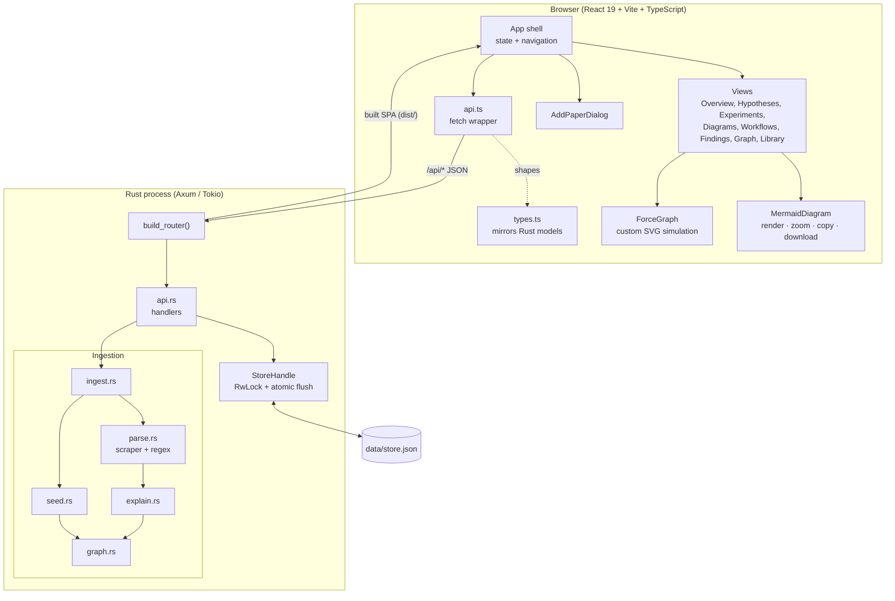
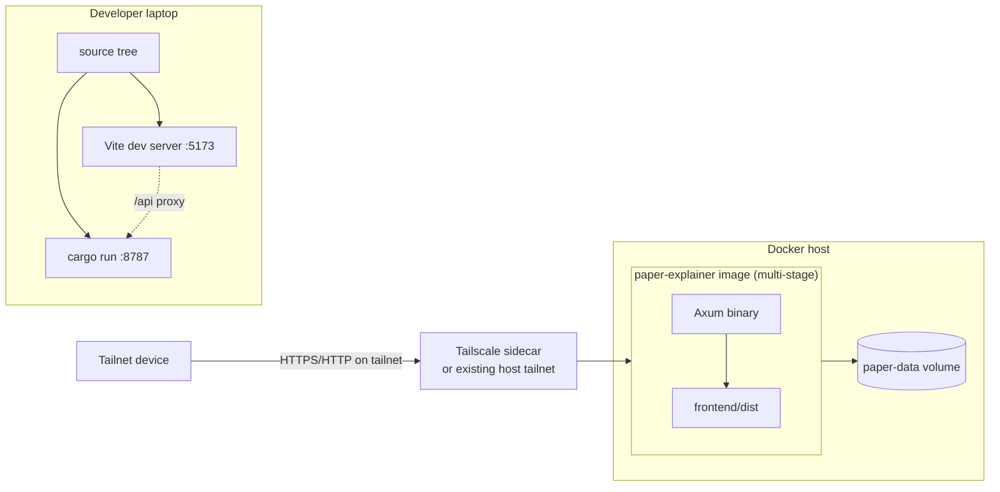

# System architecture

A deliberately small stack: one Rust process, one React bundle, one JSON file. There is no database server, message queue, or external service to operate.

## Component diagram

## Deployment diagram

## Layers and responsibilities

| Layer | Code | Owns |
|---|---|---|
| Presentation | `frontend/src/` | Views, Mermaid rendering, force graph, interaction state |
| Transport | `frontend/src/api.ts`, `backend/src/api.rs` | Typed JSON contract, error envelope, SPA fallback |
| Domain | `backend/src/models.rs` | `Paper`, `Hypothesis`, `Experiment`, `Finding`, `GraphNode/Edge` |
| Ingestion | `parse.rs`, `explain.rs`, `seed.rs`, `ingest.rs` | Turning raw paper text into domain objects |
| Graph | `graph.rs` | Deterministic node/edge derivation from all papers |
| Persistence | `store.rs` | File-backed atomic writes; swappable interface |

## Design decisions

- **File store, not a database.** `Store` is a plain serde value; a future SQLite or graph database only has to reimplement a handful of methods on `StoreHandle`.
- **Deterministic graph rebuild.** The graph is derived, never hand-edited (except user-added edges, which survive rebuilds). This keeps it correct as papers are added or removed.
- **Backend serves the frontend.** In production the Axum process serves `frontend/dist` and falls back to `index.html` for client-side routes, so there is a single deployable artifact.
- **Zoomable diagrams.** Mermaid SVGs live in a bounded, scrollable viewport with CSS `zoom` controls — see *Diagram & Mermaid guide*.
