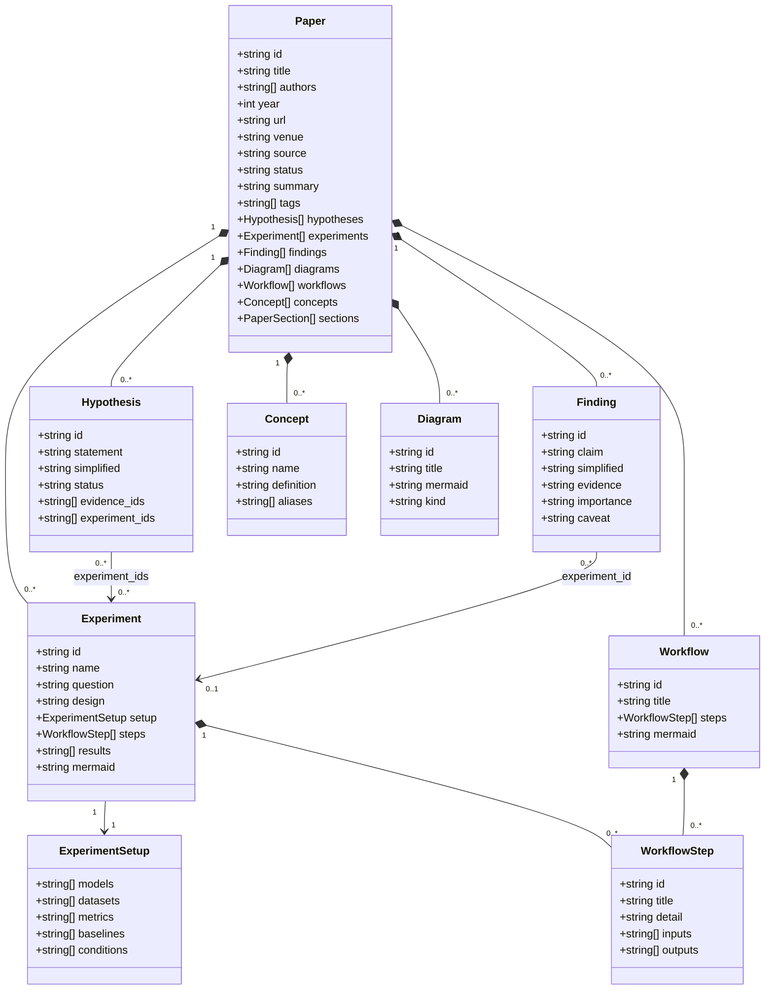
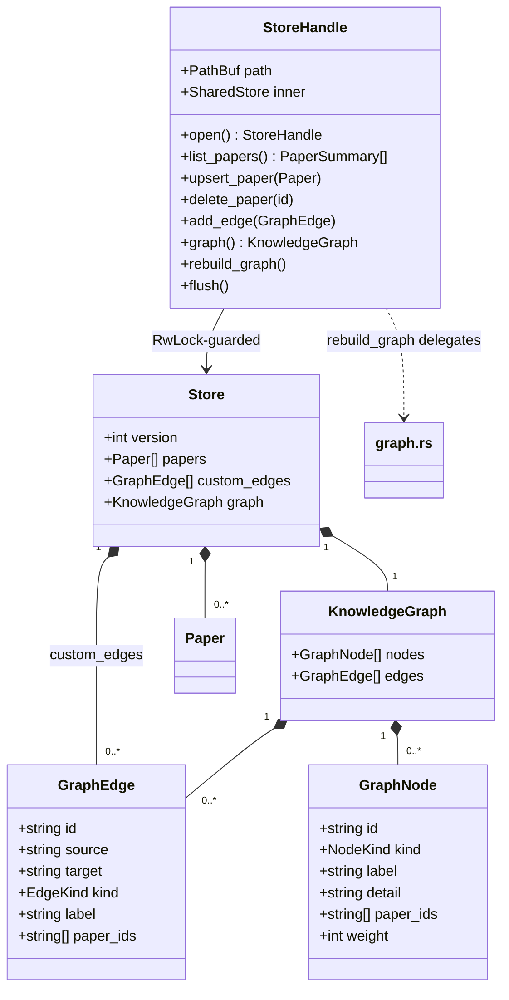
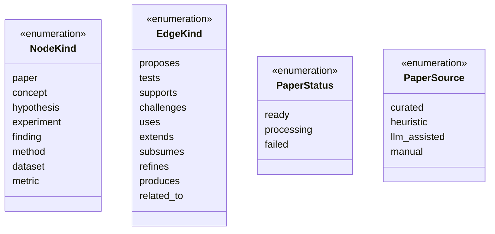
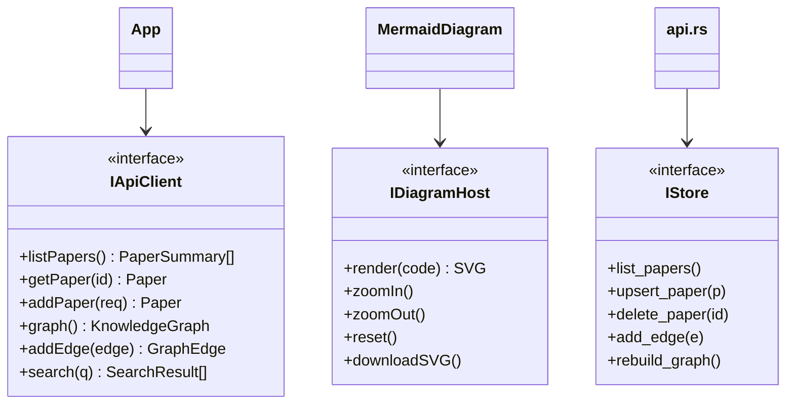

# UML — components & classes

The static structure of the system. The domain types are defined once in Rust (`backend/src/models.rs`) and mirrored in TypeScript (`frontend/src/types.ts`).

## Core domain classes

## Knowledge graph classes

The graph is a separate, derived view. Nodes carry a `kind` and arbitrary `paper_ids`, which is how shared concepts become bridges between papers.

## Node & edge taxonomies

## Interfaces (contracts between layers)

> `Paper.status` and `Paper.source` are enums serialized as strings, so the TypeScript mirror uses string-literal unions rather than classes.
