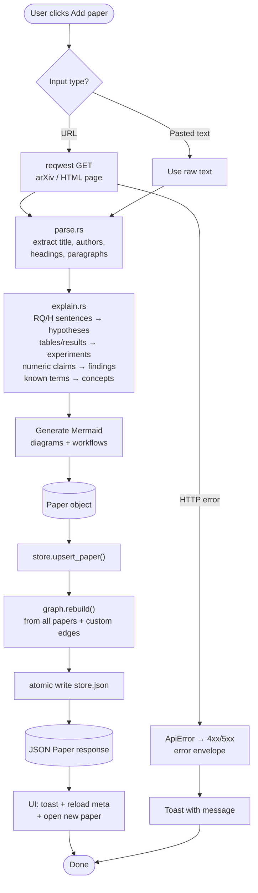
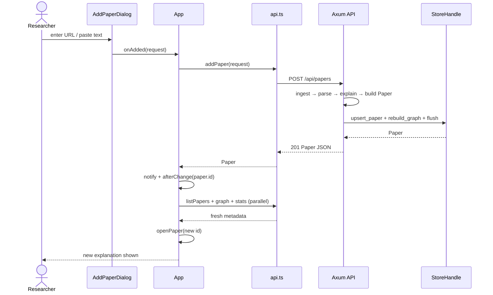
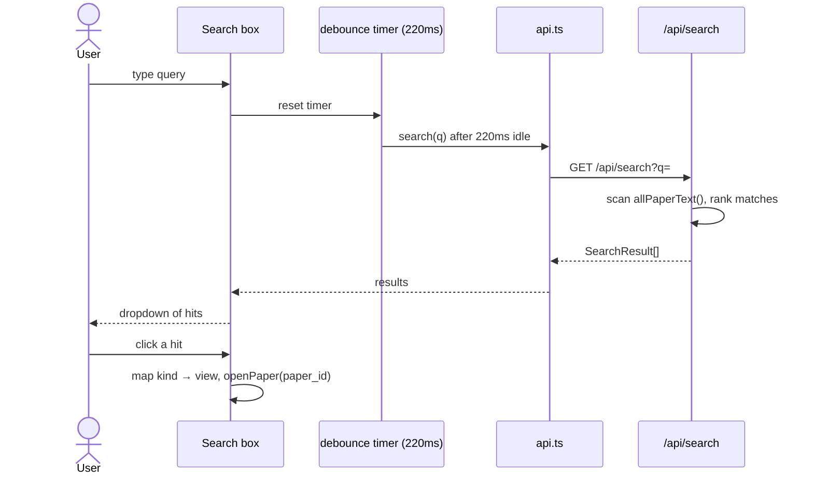
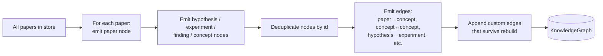
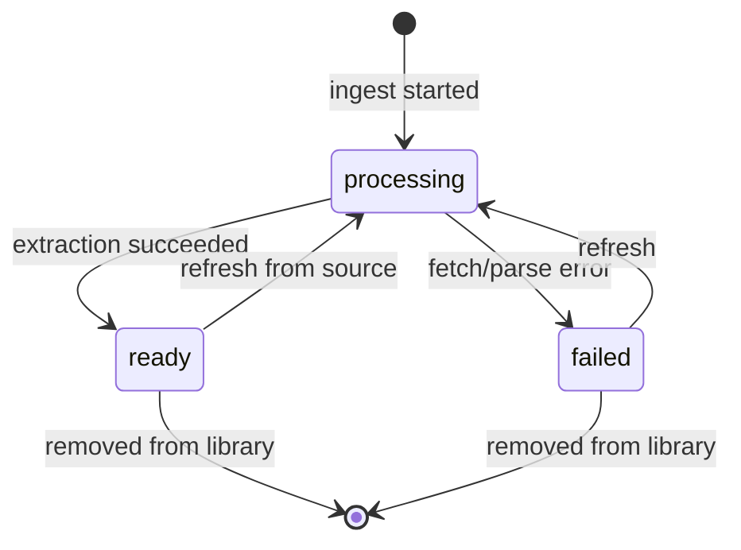

# Activity & control flow

How data moves through the system when you add a paper, and how the UI reacts.

## Ingestion activity

## Add-paper sequence

## Search interaction

## Graph rebuild activity

## Paper lifecycle state

