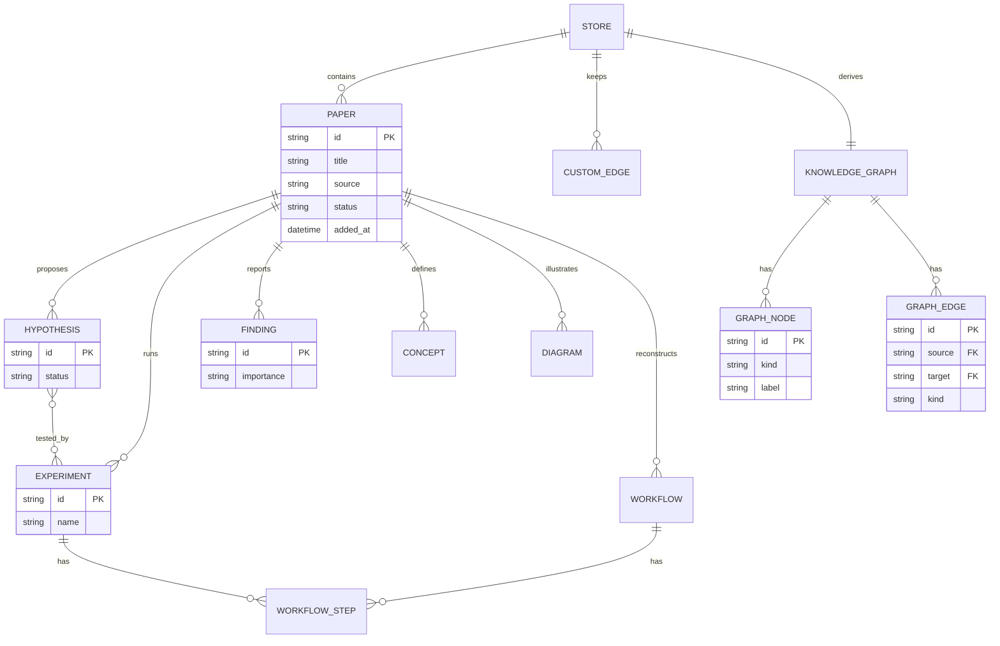
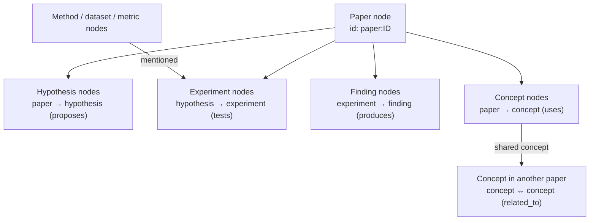

# Data model

The store is a single JSON document. It holds the papers and a derived graph; custom edges are kept separately so they survive graph rebuilds.

## Entity–relationship view

## Graph derivation rules

`graph.rs` turns papers into nodes and edges with a few stable rules:

## Persistence contract

| Concern | Implementation |
|---|---|
| Format | JSON, `version: 1` |
| Location | `PAPER_EXPLAINER_DATA` or `data/store.json` |
| Writes | Serialize to temp file, then atomic rename |
| Reads | `RwLock<Store>` shared across handlers |
| Seeding | Missing, empty, or zero-paper file → curated seed |
| Reset | `POST /api/reset` rewrites the seeded store |
| Swappability | `StoreHandle` methods are the only persistence surface |

> `GraphNode.paper_ids` is the join key that lets a single concept node belong to multiple papers — adding a second paper that mentions TEE turns the TEE node into a bridge.
