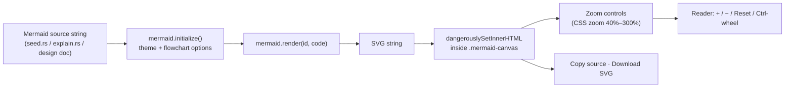
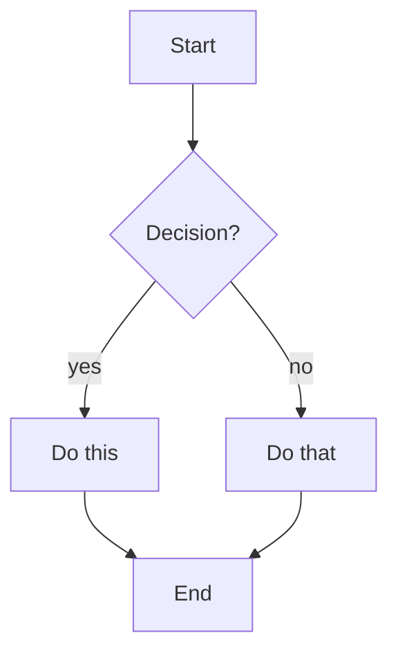
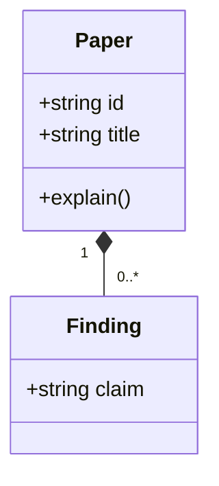
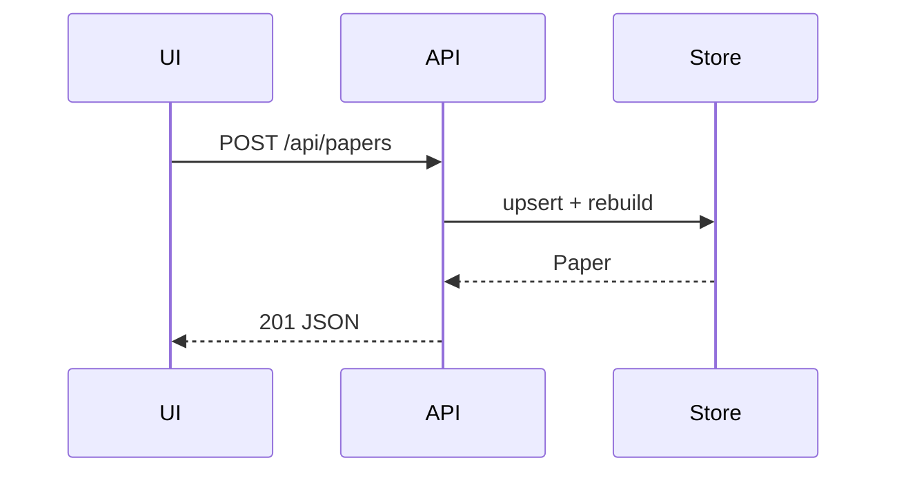
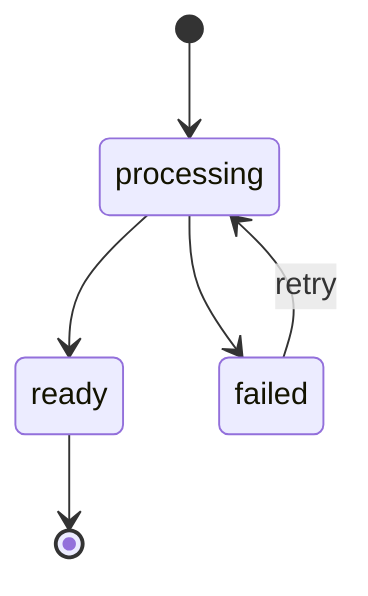
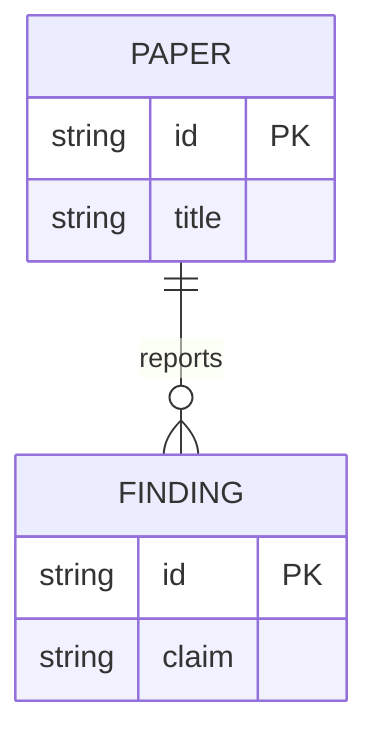

# Diagram & Mermaid guide

This app uses [Mermaid](https://mermaid.js.org/) for every illustration. Mermaid is a JavaScript library that turns a small, readable text syntax into SVG diagrams — so diagrams live as code, can be copied, and can be regenerated.

## How diagrams reach your screen

Every render uses a unique id (a monotonic counter) so React StrictMode's double-invoked effects never collide.

When you switch to dark mode, `MermaidDiagram` re-initializes Mermaid with a dark palette and re-renders
all diagrams. A few generated diagrams carry explicit `classDef` colors to distinguish nodes (for
example *secure* vs *danger*); those light tints are remapped to dark equivalents for rendering, while
**Show Mermaid source** and **Copy** still return the original, unmodified source.

## Diagram types used here

| Type | Mermaid keyword | Used for |
|---|---|---|
| Flowchart | `flowchart TB` / `LR` / `TD` | Architecture, pipelines, taxonomy, attack flow |
| Class diagram | `classDiagram` | UML classes, enums, interfaces, domain model |
| Sequence diagram | `sequenceDiagram` | API calls, search interaction, actor flows |
| State diagram | `stateDiagram-v2` | Paper lifecycle states |
| ER diagram | `erDiagram` | Data model entities and relationships |
| Architecture | `flowchart` + `subgraph` | Deployment and component boundaries |

## Flowchart (architecture / activity)

## Class diagram (UML)

## Sequence diagram

## State diagram

## ER diagram

## Reading tips

- **Arrows** show direction of flow or dependency (`-->` uses, `*--` composition, `o--` aggregation).
- **Subgraphs** (drawn as boxes) group related nodes — e.g. layers in an architecture diagram.
- **Cardinality** like `"1"`, `"0..*"`, `"many"` labels relationships in class/ER diagrams.
- **`br` in labels** (e.g. `A["line1 line2"]`) forces a line break inside a node.

## Zoom controls (this app)

The reader wraps each SVG in a bounded, scrollable viewport. Use the toolbar below a diagram:

- **− / ＋** — zoom out / in in 10% steps (40%–300%).
- **percentage** — current zoom; hover for the Ctrl/⌘ + wheel hint.
- **Reset** — back to 100%.
- **Ctrl/⌘ + wheel** over the diagram zooms without hijacking page scroll.
- **Show / Hide Mermaid source**, **Copy**, **Download SVG** — work with the diagram as text or an asset.
