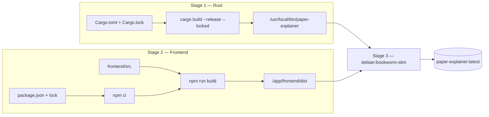
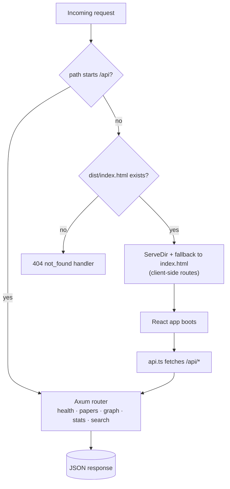
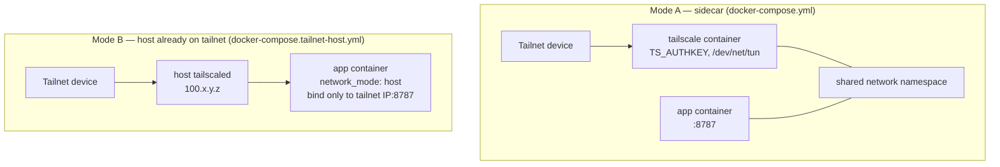

# Runtime & delivery

How the app is built, served, and reached over Tailscale.

## Build pipeline

## Request routing in the running process

## Two Tailscale modes

| Mode | When to use | Auth |
|---|---|---|
| A — sidecar | Host is not on the tailnet | Needs `TS_AUTHKEY` in `.env` |
| B — host tailnet | Host already connected (this machine) | No key needed |

## Configuration surface

| Variable | Default | Purpose |
|---|---|---|
| `PAPER_EXPLAINER_HOST` | `0.0.0.0` | Bind address (set to tailnet IP in Mode B) |
| `PAPER_EXPLAINER_PORT` | `8787` | API / dashboard port |
| `PAPER_EXPLAINER_DATA` | `data/store.json` | Persistence file |
| `PAPER_EXPLAINER_DIST` | `frontend/dist` | Built frontend to serve |
| `TS_HOSTNAME` | `paper-explainer` | Tailnet machine name |
| `TS_EXTRA_ARGS` | `--accept-dns=false` | Extra tailscale up flags |
| `TS_SERVE_CONFIG` | — | Optional HTTPS via Tailscale Serve |
| `PAPER_EXPLAINER_OLLAMA_ENABLED` | `1` | `0` disables AI enhancement |
| `PAPER_EXPLAINER_OLLAMA_URL` | `http://localhost:8210` | fox-services Ollama gateway |
| `PAPER_EXPLAINER_OLLAMA_MODEL` | `qwen3.8:27b` | Requested model |
| `PAPER_EXPLAINER_OLLAMA_TIMEOUT` | `300` | Generation timeout (seconds) |

## API endpoints

| Method | Path | Purpose |
|---|---|---|
| `GET` | `/api/health` | Service info & counts |
| `GET` | `/api/stats` | Collection statistics |
| `GET` | `/api/papers` | Paper summaries |
| `POST` | `/api/papers` | Ingest (URL or text) |
| `GET` | `/api/papers/{id}` | Full explanation |
| `POST` | `/api/papers/{id}/refresh` | Re-import from source |
| `POST` | `/api/papers/{id}/enhance` | Generate/regenerate AI explanation |
| `DELETE` | `/api/papers/{id}/enhance` | Remove stored AI explanation |
| `GET` | `/api/llm/status` | Ollama gateway readiness & models |
| `GET` | `/api/papers/{id}/export` | Markdown export |
| `DELETE` | `/api/papers/{id}` | Remove paper |
| `GET` | `/api/graph` | Knowledge graph |
| `POST` | `/api/graph/edges` | Add custom relation |
| `GET` | `/api/search?q=` | Search all papers |
| `POST` | `/api/reset` | Restore seed |

> Public DNS is kept inside the container in Mode A so the backend can still resolve and fetch arXiv pages.
