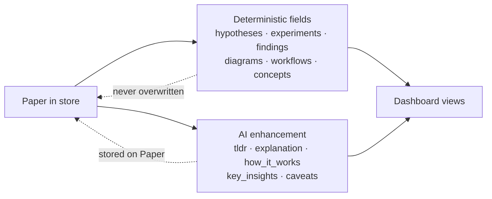
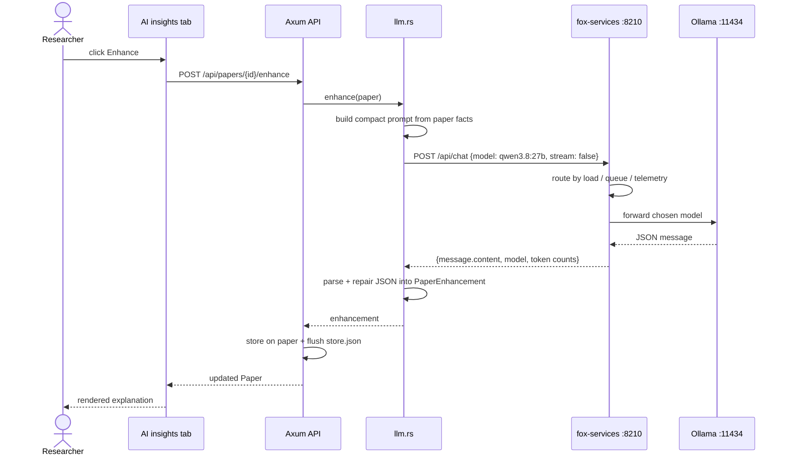
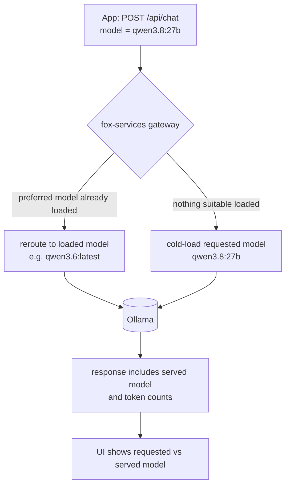
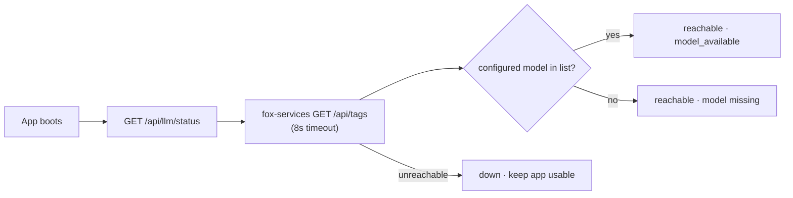
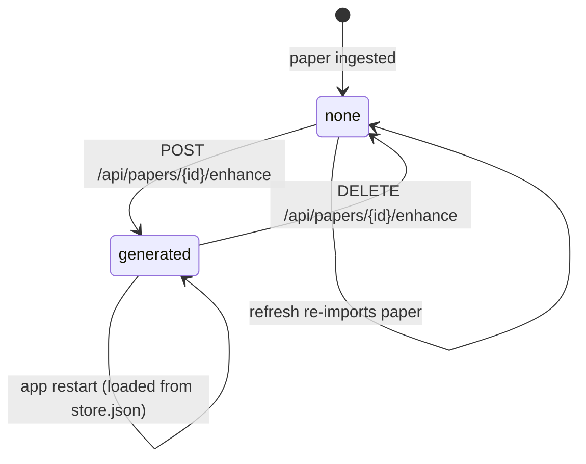

# AI enhancement layer

The app has two explanation paths. The deterministic extractor always produces the structured data
you see in Hypotheses, Experiments, Findings and Diagrams. The AI layer is **optional** and additive:
it writes a narrative explanation that lives beside that data on the same paper.

## Two paths, one paper



The AI path never mutates the deterministic fields. If the gateway is down, the deterministic views
are unchanged and the AI tab simply reports the problem.

## Request sequence



## Why fox-services, not Ollama directly

The gateway is the shared entry point for local inference on this host. It adds queueing,
per-model concurrency slots, telemetry and model routing, so one heavy request cannot swamp the
GPU for every other app.



Because rerouting is intentional, the app records both `requested_model` and `served_model`. The
UI shows a second chip whenever they differ — no silent substitution.

## Status probe



`GET /api/llm/status` never returns an HTTP error: a down gateway is a *state*, not a failure of the
app. The AI tab disables its button and shows the reason.

## Configuration

| Variable | Default | Meaning |
|---|---|---|
| `PAPER_EXPLAINER_OLLAMA_ENABLED` | `1` | `0` disables enhancement entirely |
| `PAPER_EXPLAINER_OLLAMA_URL` | `http://localhost:8210` | Gateway base URL (host networking) |
| `PAPER_EXPLAINER_OLLAMA_MODEL` | `qwen3.8:27b` | Requested model |
| `PAPER_EXPLAINER_OLLAMA_TIMEOUT` | `300` | Seconds before giving up on a generation |

In bridge networking, the gateway is `http://fox-services:8210`. The host Compose stack uses host
networking, so `localhost:8210` is already the gateway.

## Output contract

The model is asked for strict JSON, which makes a 27B model's answer storable and renderable:

```json
{
  "tldr": "one sentence",
  "explanation": "two to four short paragraphs",
  "how_it_works": "step-by-step explanation",
  "key_insights": ["takeaway one", "takeaway two"],
  "caveats": ["a limitation"]
}
```

`llm.rs` strips accidental markdown fences, escapes raw line breaks inside strings, and removes
trailing commas before parsing. If the model still returns unusable JSON, the API responds with a
`llm_error` envelope and no paper data is changed.

## Storage and lifecycle



Enhancements are part of `Paper` and therefore survive restarts and graph rebuilds. A `refresh`
re-imports the source and clears the enhancement, as the underlying paper content has changed.
