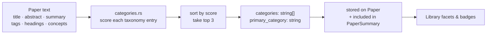
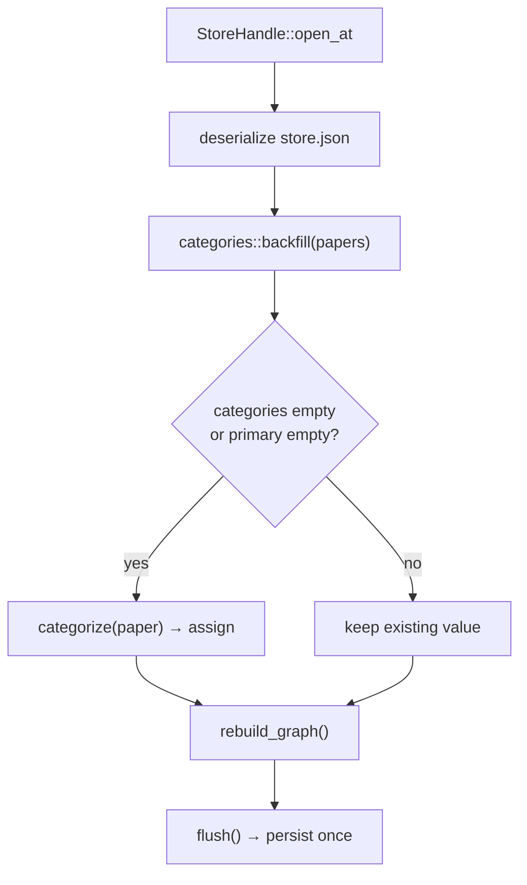
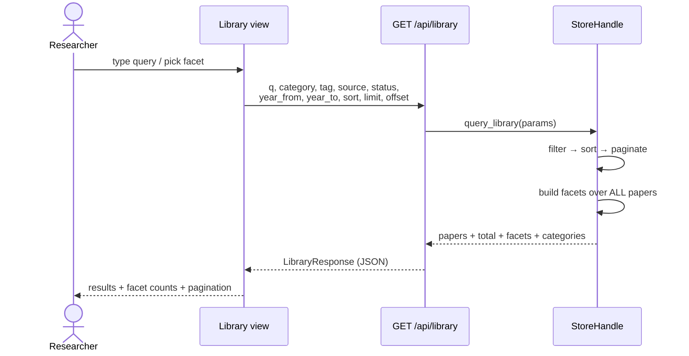
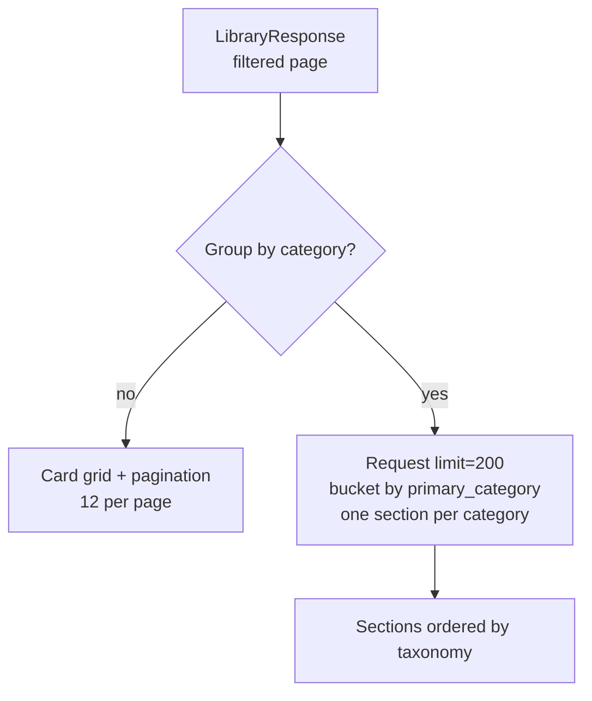

# Categorization & large-library retrieval

A small library can be scanned by eye. A few hundred papers cannot. The library therefore gains a
**deterministic subject taxonomy**, facet counts, filters, sorting, grouping and pagination — all
computed in Rust, with no LLM in the path.

## Why deterministic categories

Categories are derived from each paper's own text with a weighted keyword model. That keeps three
properties that matter for a growing corpus:

- **Stable** — the same paper always gets the same categories, so facets never shuffle on reload.
- **Explainable** — every category is a named bundle of topic keywords, editable in one place.
- **Free** — no model call, no latency, no API key; works for pasted papers and offline.



A keyword found in the **title** scores higher than one found only in the body. A paper gets up to
three categories; the highest-scoring one is its `primary_category`. If nothing matches, it falls
back to `other` rather than being left blank.

## The taxonomy

| Category id | Label | Typical signals |
|---|---|---|
| `security-privacy` | Security & Privacy | attacks, defences, encryption, obfuscation, TEE |
| `machine-learning` | Machine Learning | training, neural networks, transformers, optimisation |
| `nlp` | Natural Language | language models, text, prompts, translation |
| `vision` | Computer Vision | images, video, detection, segmentation |
| `systems` | Systems & Hardware | kernels, latency, GPUs, memory, enclaves |
| `distributed` | Distributed & Edge | consensus, replication, cloud, edge, federated |
| `data-knowledge` | Data & Knowledge | datasets, databases, indexing, knowledge graphs |
| `theory-methods` | Theory & Methods | algorithms, proofs, complexity, taxonomies |
| `hci` | Human & Society | user studies, usability, interaction, ethics |
| `robotics-control` | Robotics & Control | robots, autonomy, sensors, control |
| `other` | Other | fallback when no keyword matches |

Each entry also carries a `label`, `description` and `tone` (a badge colour), exposed through
`GET /api/categories`. The ids are stored, so they are intentionally stable even if a label is
reworded later.

## Backfill migration

Papers saved before categorisation existed are filled in at startup, before the graph is rebuilt
and the store flushed. Only papers with an empty `categories` **or** `primary_category` are touched;
manually assigned categories are preserved.



## Faceted retrieval request

`GET /api/library` returns one response containing the filtered page **and** all facet counts plus
taxonomy metadata. One round-trip renders the whole view.



Filters combine with AND; applying the same facet value again toggles it off. Facet counts are
computed over the **whole collection**, not the filtered set, so a count tells you how many papers
exist for that value regardless of the current selection.

## Filter and sort semantics

| Parameter | Behaviour |
|---|---|
| `q` | Case-insensitive substring over title, summary, abstract, tags, categories and extracted structure |
| `category` | Matches any of a paper's categories (not just the primary one) |
| `tag` | Case-insensitive exact tag match |
| `source` / `status` | Exact enum name (`curated`, `ready`, …) |
| `year_from` / `year_to` | Inclusive year range; papers without a year are excluded when a bound is set |
| `sort` | `recent` (default), `title`, `year`, `findings`, `relevance` |
| `limit` / `offset` | Page size (1–200) and offset; default 12 / 0 |

`relevance` counts how many whitespace-separated query tokens appear in a paper, then falls back to
recency for ties. `GET /api/papers` is unchanged — it still returns the simple list, so existing
clients and the sidebar keep working.

## Two ways to browse



Normal mode paginates with **Newest / Title / Year / Most findings / Relevance** sorting. Group mode
requests a larger page and renders one section per primary category, ordered by the taxonomy — useful
for surveying a whole subject at once without clicking through pages.

## Response shape

```json
{
  "papers": [ /* PaperSummary[] with categories + primary_category */ ],
  "total": 37,
  "collection_total": 214,
  "limit": 12,
  "offset": 0,
  "facets": {
    "categories": [{ "value": "security-privacy", "label": "Security & Privacy", "count": 41 }],
    "tags":        [{ "value": "security", "label": "security", "count": 33 }],
    "sources":     [{ "value": "curated", "label": "curated", "count": 1 }],
    "statuses":    [{ "value": "ready", "label": "ready", "count": 210 }],
    "years":       [{ "value": "2026", "label": "2026", "count": 58 }]
  },
  "categories": [ /* CategoryDef[] — id, label, description, tone */ ]
}
```

`total` is the number of matches for the current filters; `collection_total` is the size of the
whole library. The UI shows both so a narrow filter is never mistaken for data loss.
